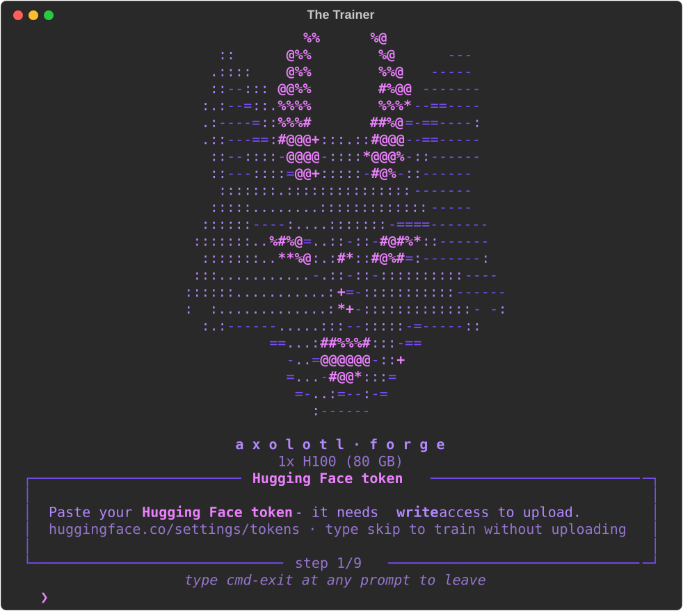
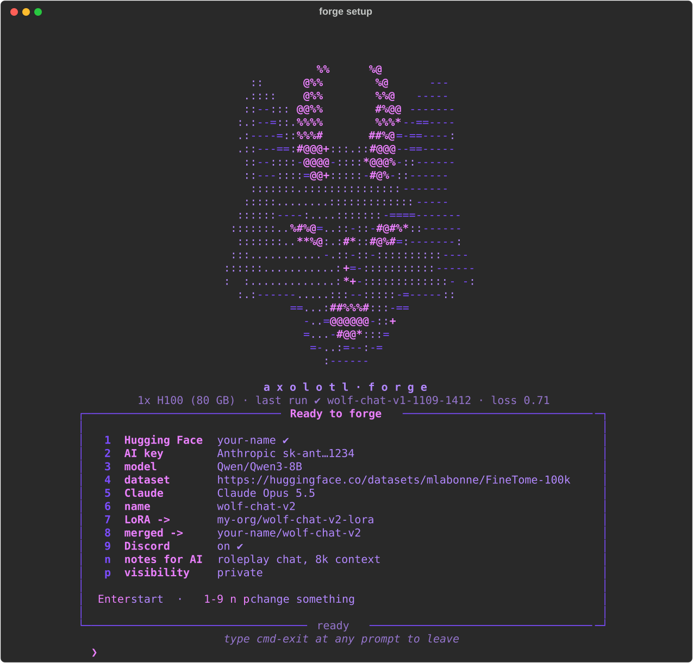

# The Trainer

A ready-to-use image for training AI models with [Axolotl](https://github.com/axolotl-ai-cloud/axolotl).
Paste a model link and a dataset link, Claude sets up the training for you, and the finished model
is uploaded to your Hugging Face account.

## What you need

- A GPU server, like a [RunPod](https://runpod.io) pod
- A Hugging Face token with **write** access ([get one here](https://huggingface.co/settings/tokens))
- An Anthropic API key (an OpenRouter key works too)
- A Discord webhook if you want messages when things finish (optional)

## Start it on RunPod

1. Go to **Templates** → **New Template**.
2. Set **Container Image** to `ghcr.io/kibafyi/axolotl-forge:latest`
3. Set **Container Disk** to 30 GB.
4. Set **Volume Disk** to 100 GB or more, mounted at `/workspace`.
5. Add **TCP port** `22`.
6. Save, then start a pod with this template.
7. Connect with SSH. The setup screen opens by itself.

## The setup screen

It asks one question at a time:

1. Your Hugging Face token
2. Your AI key
3. The model to train (link)
4. The dataset (link)
5. Claude Sonnet or Claude Opus
6. A name for your model
7. Where to upload the LoRA
8. Where to upload the merged model
9. Your Discord webhook (optional)

Then you get a summary. Press **Enter** to start, or type a number to change that answer.

## What happens next

1. The model and dataset download.
2. Claude looks at your data and your GPU and writes the training settings.
3. You look over the settings. Press **Enter** to start, or **e** to edit them.
4. Training starts. If it crashes, Claude fixes the settings and tries again, up to 3 times.
5. The LoRA and the merged model upload to Hugging Face.
6. Discord gets a message when training is done, when the upload is done, and when everything is finished.
7. You're back at the start screen, ready for the next one.

Type `cmd-exit` at any time to close the setup screen. Type `forge setup` to open it again.

If your connection drops, training keeps going. Just connect again and you'll see it.

## Links you can use

- Hugging Face, like `Qwen/Qwen3-8B` or the full web address
- Direct download links to `.jsonl`, `.json`, `.parquet`, `.csv` or `.zip` files
- Google Drive share links
- Files that are already on the server

## Start training without the setup screen (optional)

Add these to your RunPod template and training starts by itself when the pod turns on:

| Name | Example |
|---|---|
| `FORGE_MODEL` | `Qwen/Qwen3-8B` |
| `FORGE_DATASET` | `https://huggingface.co/datasets/mlabonne/FineTome-100k` |
| `HF_TOKEN` | your Hugging Face token |
| `ANTHROPIC_API_KEY` | your Anthropic key |
| `FORGE_DISCORD_WEBHOOK` | your Discord webhook |

All other settings are listed in [.env.example](.env.example).

## Handy commands

| Command | What it does |
|---|---|
| `forge setup` | Open the setup screen |
| `forge logs -f` | Watch the training log |
| `forge attach` | Go back to a training that's running |
| `forge doctor` | Check the GPUs and your keys |

## What's inside

Axolotl with all of its add-ons ready to go, including Liger, Cut Cross Entropy and DeepSpeed,
plus support for training on several GPUs at once. Weights & Biases is turned off.
The whole terminal is purple.

## Updating the image

Change the code in this repo and push it. GitHub rebuilds the image for free, and
`ghcr.io/kibafyi/axolotl-forge:latest` gets the new version. (Changes to this README don't trigger a rebuild.)
